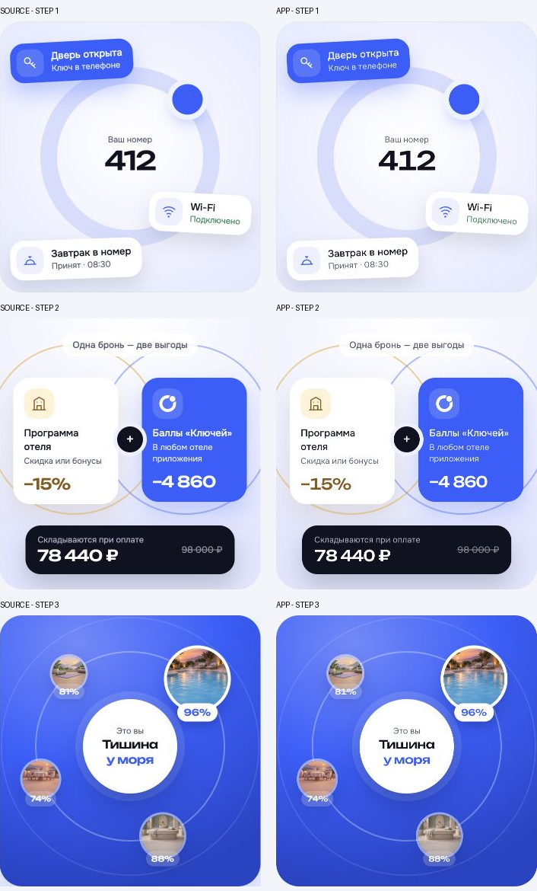

# Визуальная проверка — итерация 3

Дата: 21.10.2026. Объём: перенесённые экраны входа, знакомство, профиль и базовые компоненты. Это не аудит всего каталога исходных макетов.

## Источник и доказательства

- Визуальный источник: `../проект в Клоде/project/Ключи - Все экраны.dc.html`, a1. Рабочий эталон: `../docs/brand/reference/a1.html`, с утверждённым D-010 (без синей рамки).
- Приложение: `http://127.0.0.1:5173/#phone`, `qa/phone-implementation.png`.
- Состояние: светлое, пустой номер, клавиатура закрыта. Размер области приложения 393 × 852 CSS px, devicePixelRatio 1. Холст браузера 1400 × 1200, масштаб телефона 1.
- Исходник нормализован к 393 × 852; статусная зона увеличена для учёта runtime. Оба сравниваемых PNG — 393 × 852 физических px, без ресайза реализации. Координаты вырезки реализации: x=504, y=174. Исходник: x=0, y=0 из source-full.png.
- Полная совместная сверка: [phone-comparison.png](qa/phone-comparison.png), 806 × 882. Слева источник с D-010, справа реализация.
- Крупная сверка поля: [field-comparison.png](qa/field-comparison.png), 806 × 160. Контур, подпись, префикс и текст читаемы; синей рамки нет.

## История исправлений

1. P1: синее кольцо вокруг обычного поля a1. Убраны рамка и свечение в рабочем эталоне и компоненте. Итоговое доказательство — обе сравнительные картинки выше.
2. P2: знак первоначально оказался в центре шапки; растровая вырезка иллюстрации захватывала лишний контент. Знак возвращён влево, иллюстрация заменена точным исходным HTML-фрагментом и исходным фото. Повторная сверка выполнена.
3. P1: нажатие подтверждения могло теряться при закрытии клавиатуры. Убрана смена фокуса на pointerdown кнопки; подтверждение повторно проверено новым входом и ошибкой неполного номера.
4. P1: на Pixel клавиатура перекрывала поле телефона. При вводе декоративная иллюстрация скрывается, активное поле прокручивается в видимую область. Повторный браузерный снимок показал одновременно поле, кнопку и клавиатуру без перекрытий. Закрытая клавиатура сохраняет исходную композицию.

## Пять поверхностей сверки

- Шрифты: локальные Onest и Unbounded; заголовок 26/32, 500, −0,8 px. Явный перенос сохраняет композицию первоначального макета шириной 375 px; растянутый эталон 393 px переносит слово «свой» иначе. Это осознанное сохранение оригинальной строки.
- Композиция: знак слева, исходная центральная иллюстрация, подпись, телефон, закреплённая кнопка. Поле примерно на 10 px ниже нормализованного эталона; кнопка выше из-за безопасной области home indicator. Отличия приняты как адаптация под runtime.
- Цвет: исходный светлый градиент, кобальтовая кнопка и нейтральный телефон. Фокус серый, ошибка тёмно-красная с текстом. Служебная рамка устройства и статусная строка принадлежат runtime.
- Изображения: исходное фото и исходная геометрия иллюстрации, без приближённой перерисовки; локальные SVG исходного набора. Размытие, повреждённая прозрачность и неработающие изображения не обнаружены.
- Тексты: исходная формулировка входа сохранена. В онбординге согласованы условия ключа и FR, убраны неподтверждённые обещания. В коде используется единое доступное поле на шесть цифр вместо отдельных визуальных ячеек; это осознанное упрощение ввода.

## Сценарии и проверки

Браузер: три шага знакомства, пропуск до последнего шага, переход к поиску; новый и повторный вход, неверный и истёкший код, повторная отправка, неполный телефон; профиль и дополнительный путешественник, несохранённая форма; шторка UI kit и Escape. Сохранение пользователя проверено обновлением страницы. Проверены устройства iPhone 393 × 852 и Pixel 427 × 952, клавиатура и нижняя кнопка. Ошибок и предупреждений консоли при проверке не было.

Автоматически: 39 тестов логики проходят; сборка TypeScript/Vite проходит; 28 защищённых файлов runtime неизменны; валидаторы продукта и бренда проходят.

Остаточные границы: узкий внешний холст браузера и реальные мобильные браузеры ещё требуют отдельной проверки; свайп онбординга не реализован, используются кнопки. Поиск и бронирование вне этой итерации. Новые экраны проходят такую же сверку при переносе.

## Итог

Открытых P0/P1/P2 в проверенном объёме нет. Проверены общий вид и крупный фрагмент поля после исправлений. Следующий шаг — компоненты поиска и бронирования.

## Обновление D-011 — анимации онбординга

Источник движения: `../проект в Клоде/project/github-onboarding/src/onboarding-variant-1.dc.html`; браузерный источник — одноимённый самостоятельный HTML в родительской папке. Реализация: `src/onboarding/`, маршрут `#welcome`.

Проверены в браузере заставка «ключ → орбита», появление первого шага, последовательные переходы, возврат кнопкой и полосками, переключение стрелкой клавиатуры, пропуск, завершение в поиск и отдельное завершение во вход. Неактивные панели отсутствуют в дереве доступности. Все четыре фотографии третьего шага загрузились. Тайминги вычисленных стилей: opacity 600 мс и transform 800 мс с кривыми источника; внутренние задержки и transform перенесены из его функции anim. Режим reduced motion реализован, но системное переключение этой настройки в браузере отдельно не проверялось.

Совместные изображения: [полные экраны](qa/onboarding-comparison.png) и [иллюстрация крупно](qa/onboarding-art-comparison.png). Реализация снята в 393 × 852 CSS px, DPR 1, холст 1400 × 1200. Источник имеет область 375 × 780; полностраничный снимок инструмента оказался в масштабе 0,5, поэтому вырезка 188 × 390 нормализована до 375 × 780. Для точной сверки графики использован отдельный нативный снимок 1280 × 720: вырезка 343 × 356, без масштабирования, рядом с иллюстрацией приложения 361 × 356. Расширение карточки на 18 px обусловлено шириной телефона; размеры кольца, карточек и типографики сохранены.

Пять поверхностей: шрифты Onest/Unbounded и размеры действующего приложения сохранены; отступы и безопасные области принадлежат текущей оболочке; цвета, градиенты и изображения исходные; иллюстрации перенесены с оригинальными орбитальными контейнерами; согласованные тексты о ключе и Friendly Rate не заменены старыми обещаниями. Добавлены три полоски прогресса из референса. Шапка и статусная строка остаются неподвижными. Отличия от полной копии источника намеренные: текущая шапка, тексты, больший экран и настоящие маршруты вместо демонстрационного тупика.

Найден и устранён P1: родитель фиксированных слоёв имел нулевую высоту, при фокусе кнопки браузер прокручивал оболочку устройства. Родитель получил position:absolute/inset:0; повторные нажатия и стрелка клавиатуры сохраняют scrollTop устройства равным нулю. После исправления выполнены снимки выше. Историческая ошибка HMR во время промежуточного редактирования устранена; после перезагрузки и финальной проверки новых ошибок нет. TypeScript/Vite build и проверка 28 защищённых файлов проходят. Открытых P0/P1/P2 в данном изменении нет.

final result: passed

## Повторный аудит D-011 — исправлено реальное воспроизведение

21.10.2026, после сообщения пользователя о расхождении. Предыдущий вывод passed был недостаточным: статические снимки и совпадение CSS-таймингов не обнаружили пересоздание DOM во время переходов. Следующие результаты уточняют и заменяют прежний вывод об анимации и допустимости ширины 361 px.

### Найдено и исправлено

1. P1 — при изменении шага и обновлении родительского таймера React повторно назначал innerHTML иллюстрации. Элементы теряли предыдущее положение, появлялись сразу в финальном или обрывали движение. Теперь memo-компонент сохраняет DOM; меняются наследуемые CSS-переменные. В браузере повторно наблюдались начальные повороты −70°/+70°, scale(.5), кольца .88/.94 и opacity:0, затем конечные состояния.
2. P2 — первый экран дополнительно въезжал целиком после заставки. Теперь панель заранее стоит на месте; после заставки начинают движение внутренние элементы, как в источнике. Восстановлены порядок наложения панелей и исходный непрозрачный фон.
3. P2 — глобальные border-box и line-height, растяжение холста до 361 px и три пропущенных разделителя в извлечённых inline-стилях меняли геометрию карточек и центры вращения. Восстановлен холст 343 × 356 и CSS-контекст исходника.

### Покадровые состояния и параметры

Сопоставлены вычисленные transform, opacity, transition-delay, transition-duration, transition-timing-function, transform-origin у всех 31 анимированных элементов: шаг 1 — 9, шаг 2 — 7, шаг 3 — 15. В конечных состояниях и настройках переходов расхождений не найдено. Отдельно наблюдались начальные и промежуточные состояния третьего шага; это проверка состояний и параметров, не синхронизированное видео с миллисекундной точностью.

- Шаг 1: кольцо → точка по орбите → номер → карточки; задержки .05/.2/.45/.55/.7/.85 с. Карточки заходят с поворотом −34°, внутреннее содержимое компенсирует вращение.
- Шаг 2: круги со смещением ±64 px, карточки ±40 px, затем плюс и итог со смещением 18 px. Задержки .1/.2/.65/.8 с.
- Шаг 3: кольца и центральная карточка, затем четыре отеля по орбитам с задержками .35/.5/.65/.85 с; повороты −70°/+70° и scale(.5).
- Панели: opacity 600 мс, translateX 36 px / scale(.98) за 800 мс; исходные easing сохранены.

Данные браузера: [шаг 1](qa/motion-fix/01-motion.json), [шаг 2](qa/motion-fix/02-motion.json), [шаг 3](qa/motion-fix/03-motion.json).

### Визуальное доказательство

Нативные снимки источника: холст 1280 × 720, вырезка x=469/y=235, 343 × 356. Приложение: холст 1129 × 1166, телефон 393 × 852, вырезка x=393/y=269, 343 × 356. Масштабирования нет. В финальных снимках и переходах обычными кликами scrollTop устройства равен 0. Программный locator.click инструмента мог прокручивать скрытую область устройства; итоговые снимки пересняты после обновления страницы обычными CUA-кликами.

Пять поверхностей: локальные Onest/Unbounded сохранены; размеры исходных иллюстраций восстановлены; цвета и фотографии исходные; карточки, кольца и центры вращения совпадают; согласованные тексты о ключе и Friendly Rate сохранены. Шапка и безопасные области остаются из текущего приложения.

Последовательные переходы 1 → 2 → 3 и завершение через финальную анимацию в #find повторно проверены обычными кликами. TypeScript/Vite build и контроль 28 защищённых runtime-файлов проходят. Проверка системного reduced motion и реальных мобильных браузеров в этот повторный аудит не входила.

Открытых P1/P2 в проверенной анимации нет. final result: passed.

## Общие микровзаимодействия — 21.10.2026

Реализованы на текущих экранах нажатия общих кнопок и строк, тумблер, нижнее меню и тосты. Визуальный эталон и тексты сохранены. Состав и границы — ../docs/iteration-3/COMPONENTS.md.

В браузере проверены: последовательные и быстрые переключения четырёх вкладок; одновременное растворение двух страниц (opacity .683428/.316572); inert и aria-hidden у уходящей страницы, удаление её из DOM после завершения; возврат повторным нажатием «Поездки» из scrollTop 29 в 0; открытие справки о баллах и закрытие с возвратом фокуса; исчезновение и возврат меню; переключение Switch туда/обратно; появление и автоматическое исчезновение Toast. Внешняя область устройства сохраняла scrollTop 0.

Вычисленные стили: возврат кнопки 240 мс arrive; подложка 240 мс ios-push; бегунок 300 мс click, конечное смещение 18 px. CSS нажатия задаёт scale .97 / 120 мс; отдельная запись удержания кнопки не выполнялась. Тост наблюдался в начальном состоянии opacity 0 / translateY 15.7853 px, затем исчез после выдержки. [Данные перехода](qa/interactions/computed.json), [состояние тумблера](qa/interactions/switch.png), [экран поиска](qa/interactions/find.png).

TypeScript/Vite и проверка 28 защищённых файлов runtime проходят. Системное reduced motion отдельно не переключалось; предусмотрено в CSS/компонентах. Реальные мобильные браузеры не проверены. Точные тайминги шторок и переходы вложенных экранов не входят в этот результат.

## Итерация 4 · 21.10.2026

В in-app browser проверены выдача, отель, номер и оба тарифа, форма гостя с клавиатурой, оплата и подтверждение. Даты и гости меняют цену. Проверены отказ/повтор оплаты, сохранение брони после reload и бесплатная отмена с возвратом двух кошельков. Второй путь — FR на две ночи, баллы и оплата при заселении: 13 600 ₽ остатка, 0 ₽ оплачено, 1240 баллов отеля не использованы. Нейтральный фокус телефона сохранён. Footer оплаты получил непрозрачный фон, ошибка видна рядом с действием. Успех использует SVG-штрих вместо текстового символа. Все 53 проверки логики и сборка прошли, 28 защищённых runtime-файлов целы. Полная адаптация Android и всех размеров относится к следующим проверкам; не заявляется выполненной этим проходом.

## Повторная сверка поиска и бронирования

21.10.2026: исправлена композиция c1/h1/h5/h7 после замечания пользователя. Отчёт, история исправлений и сравнения — [design-qa.md](../design-qa.md). Проверены фильтры, сортировка, избранное, галерея, отзывы, форма с клавиатурой и новая демобронь с отменой. Итог выбранного визуального прохода: passed; вся итерация 4 остаётся в работе.

## 22.10.2026

Текущая визуальная проверка поиска, окон, меню, услуг и подтверждения — [../design-qa.md](../design-qa.md). Скриншоты: qa/search-2026-10-22/. Полный сценарий пока не завершён: ../docs/iteration-4/FLOW-AUDIT.md.

## 23.10.2026 — D-045, компактные действия карточки

Источник: `/Users/tatyana.glazyrina/.codex/generated_images/01a15f51-a729-7521-8664-1d3c42c39e78/exec-fd027585-d2dc-4b1d-ab76-06ae6ac66d44.png` — выбранный вариант 2 с горизонтальным расположением и сокращёнными подписями. Исходник — концептуальный board 1424×1106, а не экран 1:1. Объём сравнения — блок двух действий; остальная карточка сохраняет действующие компоненты приложения.

Реализация: `../docs/iteration-5/action-variants/stay-final.png`, `../docs/iteration-5/action-variants/upcoming-final.png`, снимки браузера 1550×1176; область телефона 393×852 CSS px, масштаб 1, координаты x578.5/y162. Источник и оба снимка открыты вместе для сравнения. Плотность концепта отличается: сравнивались расположение/иерархия и характер кнопок, а точные размеры сверены через DOM. Это не попиксельная проверка всей карточки.

На обоих состояниях: единая горизонтальная пара, равные колонки, одинаковые фон/граница/иконки, высота 48, шрифт Onest14/20, gap8. Ширина каждой кнопки 158.5 px при проживании и 160.5 px до заезда вследствие сохранённых внутренних отступов карточек. Надписи не переносятся и не переполняются. Основная кнопка выше белая; вторичные действия менее контрастны по фону. Документ и QR взяты из исходного набора иконок.

Проверены переход «Детали» → детали брони → назад и «Поделиться» → QR/режимы доступа. Режим проживания возвращён после проверки состояния до заезда. Сборка и 28 protected-файлов прошли. Новых функциональных правил нет, отдельные доменные тесты для визуального изменения не добавлялись.

Findings: P0/P1/P2 в изменённом блоке не обнаружены. Сравнение выполнено одним проходом; исправления после него не потребовались. Не оценивались другие сценарии, Android и весь каталог экранов.

final result: passed
