# Иконки предпочтений «Ключей»

**Актуальный утверждённый набор · 2 ноября 2026.** Используется в мобильном прототипе: выбор стиля путешествий, «Под ваши предпочтения» и «Почему подходит вам». Для дизайна, разработки и маркетинга.

[Скачать весь набор ZIP](keys-preference-icons.zip) · [Отдельные PNG](#отдельные-иконки) · [Правила применения](../../../../docs/handoff/PREFERENCE-ICONS.md)

## Превью

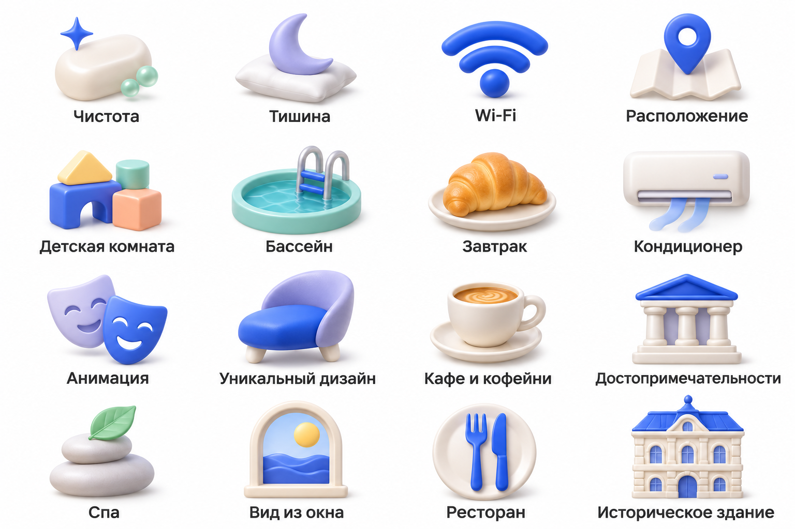
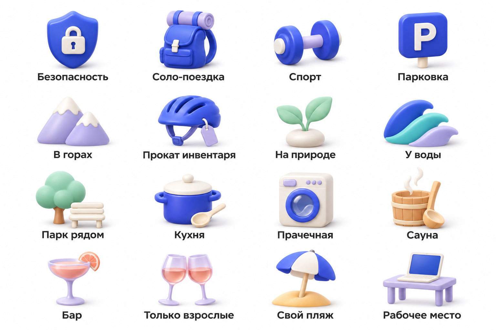

## Форматы и применение

- 32 отдельных PNG без текстовых подписей, в исходном разрешении фрагментов (без искусственного увеличения).
- Два исходных превью PNG 1536 × 1024, подписи сохранены для обзора.
- manifest.json: идентификаторы, русские названия и соответствующие файлы.
- Основа изображений белая, **это не прозрачные PNG и не SVG**. На светлой поверхности допустим Multiply; на тёмной используйте белую подложку, как в приложении. Для крупной печати разрешение ограничено.
- Сохраняйте пропорции, объём, палитру и мягкие тени. Не перекрашивайте иллюстрации в монохром.
- Этот набор дополняет контурные UI-иконки в родительской папке; не заменяет логотип, навигацию и системные статусы.
- Источник — утверждённые генерации; это текущий сет 1. Отвергнутые варианты не включены.

## Отдельные иконки

| Превью | Название | PNG |
|---|---|---|
| 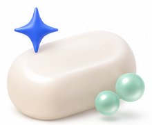 | Чистота | [cleanliness.png](png/cleanliness.png) |
| 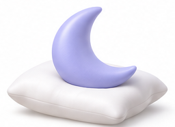 | Тишина | [quiet.png](png/quiet.png) |
| 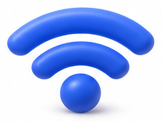 | Wi-Fi | [wifi.png](png/wifi.png) |
| 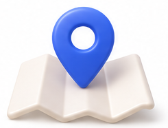 | Расположение | [location.png](png/location.png) |
| 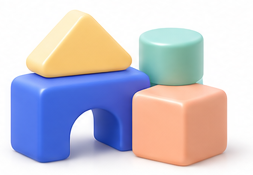 | Детская комната | [kids.png](png/kids.png) |
| 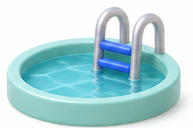 | Бассейн | [pool.png](png/pool.png) |
| 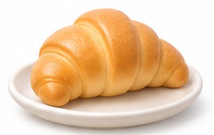 | Завтрак | [breakfast.png](png/breakfast.png) |
| 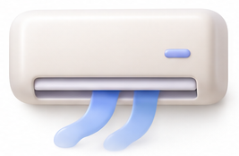 | Кондиционер | [air.png](png/air.png) |
| 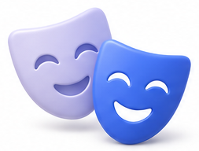 | Анимация | [entertainment.png](png/entertainment.png) |
| 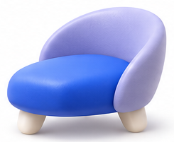 | Уникальный дизайн | [design.png](png/design.png) |
| 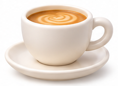 | Кафе и кофейни | [coffee.png](png/coffee.png) |
|  | Достопримечательности | [attractions.png](png/attractions.png) |
|  | Спа | [spa.png](png/spa.png) |
| 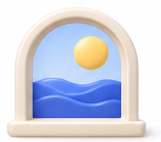 | Вид из окна | [view.png](png/view.png) |
| 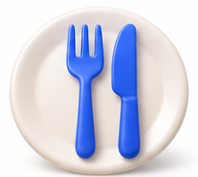 | Ресторан | [restaurant.png](png/restaurant.png) |
| 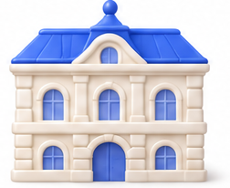 | Историческое здание | [historic.png](png/historic.png) |
|  | Безопасность | [security.png](png/security.png) |
| 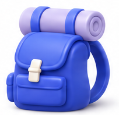 | Соло-поездка | [solo.png](png/solo.png) |
|  | Спорт | [sport.png](png/sport.png) |
| 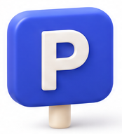 | Парковка | [parking.png](png/parking.png) |
| 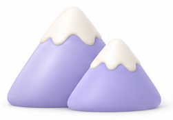 | В горах | [mountains.png](png/mountains.png) |
| 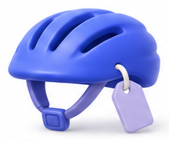 | Прокат инвентаря | [rental.png](png/rental.png) |
| 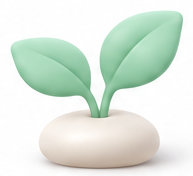 | На природе | [nature.png](png/nature.png) |
| 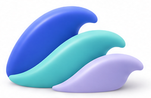 | У воды | [water.png](png/water.png) |
| 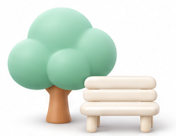 | Парк рядом | [park.png](png/park.png) |
| 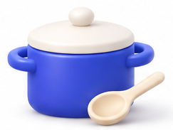 | Кухня | [kitchen.png](png/kitchen.png) |
| 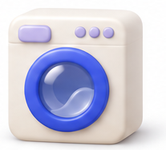 | Прачечная | [laundry.png](png/laundry.png) |
|  | Сауна | [sauna.png](png/sauna.png) |
| 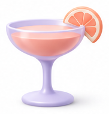 | Бар | [bar.png](png/bar.png) |
| 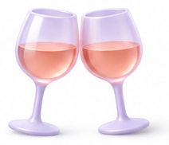 | Только взрослые | [adults.png](png/adults.png) |
| 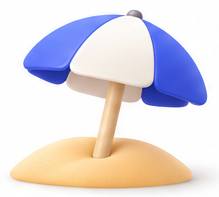 | Свой пляж | [beach.png](png/beach.png) |
| 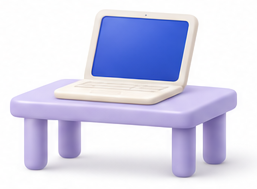 | Рабочее место | [work.png](png/work.png) |
