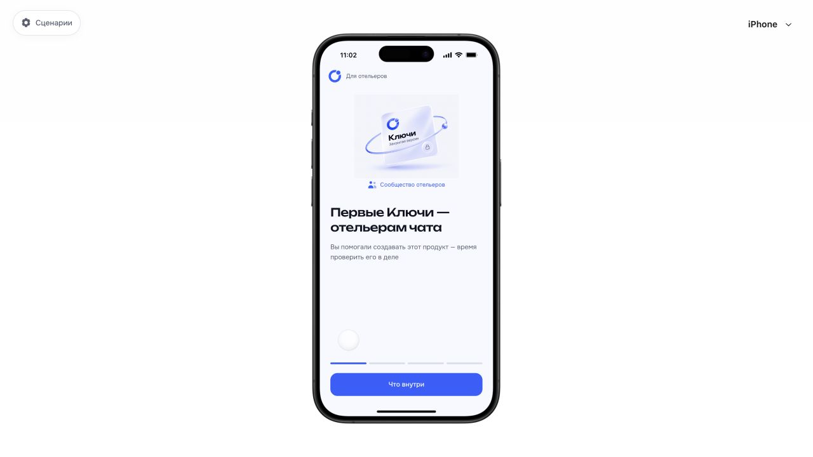
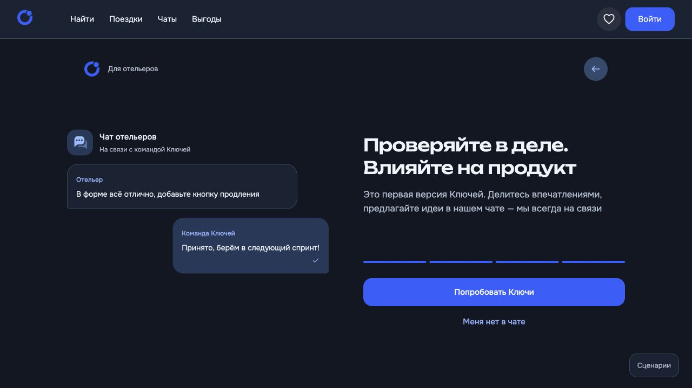

# Онбординг отельера (Эд, Юра)

13.11.2026 · Подготовлено к публикации на GitHub Pages по запросу пользователя.

## Вход

Настройки прототипа → Вход и регистрация → Онбординг для отельера (Эд, Юра).
Каталог: `hotelier-pilot`, `hotelier-pilot-2`, `hotelier-pilot-3`, `hotelier-pilot-4`.
[Мобильный прототип](http://127.0.0.1:5173/?catalogue=hotelier-pilot&variant=november&icons=new&text=edited#hotelier-pilot).

## Состав

Четыре экрана по референсу https://klyuchi-onboarding-pilot.fruitypier.chatgpt.site/: приглашение сообщества, Friendly Rate, подключение участия через TravelLine и подтверждение профиля, обратная связь. Использованы Onest/Unbounded, общие кнопки/иконки/статусы и существующая брендовая иллюстрация. Мобильная и десктопная компоновки, светлая и тёмная темы. Новый сценарий независим от существующего «Новый отельер» и доступен в обеих версиях прототипа.

После «Попробовать Ключи» — существующие телефон, СМС, имя и подтверждение отельера. Роль автоматически не выдаётся. После подтверждения либо «Подтвердить позже» открываются «Поездки» без повторного общего онбординга. Старый сценарий сохраняет прежнее продолжение. Подготовка нового сценария сохраняет существующие профили и брони.

Ссылка Telegram в референсе — заглушка. В прототипе «Меня нет в чате» открывает шторку с явным сообщением, что ссылка ещё не подключена. Реальных SMS/TravelLine-интеграций не добавлено. Существующие тексты и редакции не переписаны.

## Проверка

- 12 тестов demo-entry прошли, включая новый сценарий и сохранение старого продолжения.
- TypeScript мобильной и десктопной сборки, production build мобильного приложения — успешно.
- Защищённый runtime: 28 файлов, проверка пройдена.
- Браузер: все четыре шага, навигация, шторка чата, телефон → СМС → имя → отельер → «Подтвердить позже» → Поездки, повторный запуск из настроек.
- Визуально: мобильная светлая тема, десктопная тёмная тема; исправлены наложение иллюстрации чата на заголовок на малой высоте и выравнивание десктопного подвала.

13.11.2026 · Уточнение онбординга отельера (Эд, Юра): приглашение собрано вектором и текстом без фонового квадрата, с надписями «Сообщество отельеров», «Приглашение для своих», «Закрытый релиз». На первом шаге «Пропустить» под CTA, на остальных справа от «Назад», переход сразу в регистрацию. Второй шаг — демонстрационная карточка отеля с Friendly Rate; третий — связанная последовательность промокода в TravelLine и подтверждения профиля с результатом открытия тарифа. Диалог: отельер справа, команда слева; одноразовая анимация сообщения, набора и ответа с поддержкой reduced motion. Локально.

Повторная проверка: TypeScript обеих версий, runtime 28 файлов; в браузере проверены пропуск в телефон, все обновлённые иллюстрации, индикатор набора и ответ, светлая мобильная и тёмная десктопная компоновки.

13.11.2026 · По уточнению пользователя «Назад» в онбординге Эд/Юра перенесена из шапки под основную кнопку на шагах 2–4. «Пропустить» остаётся в шапке. На последнем шаге вторичные действия «Назад» и «Меня нет в чате» расположены в одну строку. Проверены переход назад/вперёд, TypeScript и защищённый runtime.

13.11.2026 · Последний шаг онбординга Эд/Юра: действия под основной кнопкой теперь вертикальные; «Меня нет в чате» использует общий Button secondary. Под увеличенный подвал зарезервирован отступ контента. Проверены TypeScript, runtime и мобильное отображение.

13.11.2026 · Шаг 2 онбординга Эд/Юра: карточка отеля уже и центрирована (максимум 310 px мобильная / 360 px десктопная), Friendly Rate перенесён с фото в строку новой цены. Сгенерировано фото вымышленного отеля у моря встроенным image_gen, локальный ассет hotelier-pilot-seaside.png. Промпт сохранён в seaside-image-prompt.txt рядом с отчётом.

13.11.2026 · Уточнение карточки второго шага: пользователь имела в виду уменьшение высоты, не ширины. Возвращена полная ширина иллюстрационного блока, уменьшены высота фото и внутренние отступы; рейтинг и цена вновь в одном нижнем ряду. Иконка избранного убрана, Friendly Rate сохранён рядом с ценой.

## Проверки перед публикацией

Все 526 тестов прошли. В восьми наборах тестов с ноябрьскими фикстурами часы зафиксированы на 01.11.2026 через штатный node:test MockTimers: реальные даты больше не делают тестовые брони прошедшими. Рабочая логика дат не менялась. Проверка 171 иконки, брендбука, спецификации и защищённого runtime пройдена. Декоративная орбита приглашения вынесена в отдельный SVG-ассет.

13.11.2026 · Карточка второго шага онбординга: Friendly Rate теперь под ценой вместо «за ночь». Старая и новая цены в одной строке, что дополнительно сокращает высоту карточки; ширина сохранена. Локальная правка после публикации 3f867d2.

13.11.2026 · Второй шаг онбординга: текстовая часть карточки уплотнена в две колонки (название, адрес, рейтинг слева; старая цена над новой и Friendly Rate под ней справа). Фото увеличено на 20 px: 160 px мобильная / 200 px десктопная версия. Ширина карточки сохранена.

13.11.2026 · Последний шаг онбординга: иллюстрация оформлена компактным окном группового чата с отдельной шапкой «Чат отельеров», индикатором связи, небольшими аватарами и временем сообщений. Уменьшены отступы и размер демонстрационных сообщений; исходящее справа, ответ команды слева. Анимация набора и появления ответа сохранена.

## Карта приглашения · 13.11.2026
Первый шаг пересобран как горизонтальная клубная карта пропорций 1.586:1: бренд слева сверху, сообщество справа, крупное приглашение по левой оси, статус закрытого релиза в отделённом нижнем ряду. Кобальтовая поверхность, белый текст, декоративная орбита внутри правого края. Существующие формулировки и сценарий сохранены. Проверены TypeScript, protected runtime и мобильный вид; скриншот `invitation-card.png`. Изменение локальное.

## Акценты заголовков
На четырёх шагах выделены фирменным цветом `--theme-link`: «отельерам чата», «скидки для своих», «тарифы», «Влияйте на продукт». Размер, начертание и формулировки сохранены; цвет адаптируется к теме. Проверены TypeScript и переходы между четырьмя шагами в браузере. Скриншот: `title-accents.png`.

## Публикация визуальных уточнений
13.11.2026: пакет включает клубную карту первого шага, компактную карточку отеля со старой ценой над новой, диалог с аватарами и акценты четырёх заголовков. Перед отправкой прошли 526 тестов, check:icons, брендовые/продуктовые проверки, сборка обеих версий, проверка 2189 ссылок/ассетов, 159 сцен и маркетингового раздела.
