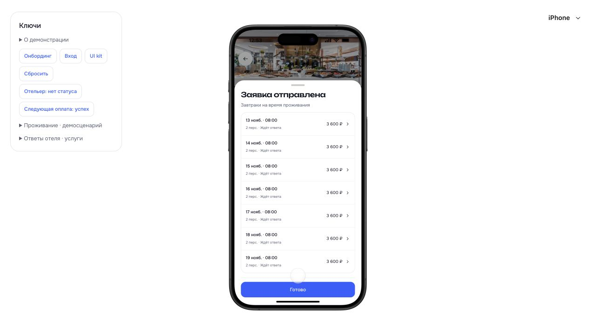
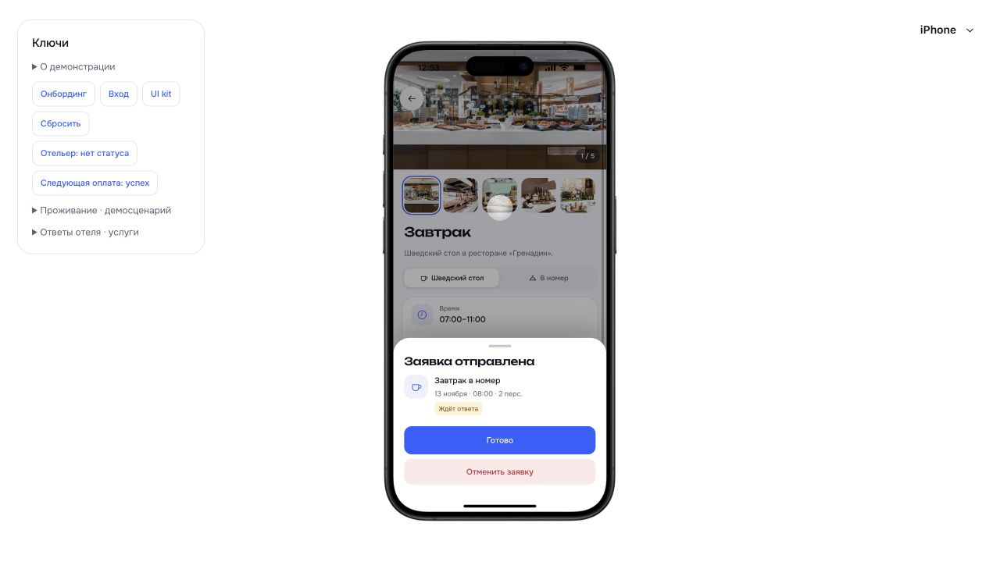

# Завершение заявки на завтрак

23.10.2026. D-039.

- В общей заявке на всё проживание «Готово» закрывает BottomSheet и открывает #trips.
- В заявке на отдельный завтрак «Готово» закрывает ServiceOrderSheet и открывает #trips. Предыдущее окно группы не появляется снова.
- Браузерная проверка выполнена на существующей ожидающей заявке из семи дней и её отдельной дате. Новые заказы и платежи при проверке не создавались. После отправки используются эти же окна и обработчики.
- В установившемся состоянии кнопка полностью видима над нижним индикатором. Первичный снимок во время анимации не использован как основание для изменения размеров.
- npm --prefix app run build: успешно, TypeScript и Vite; 28 защищённых файлов runtime не изменены. Предупреждение Vite о размере сборки остаётся.

