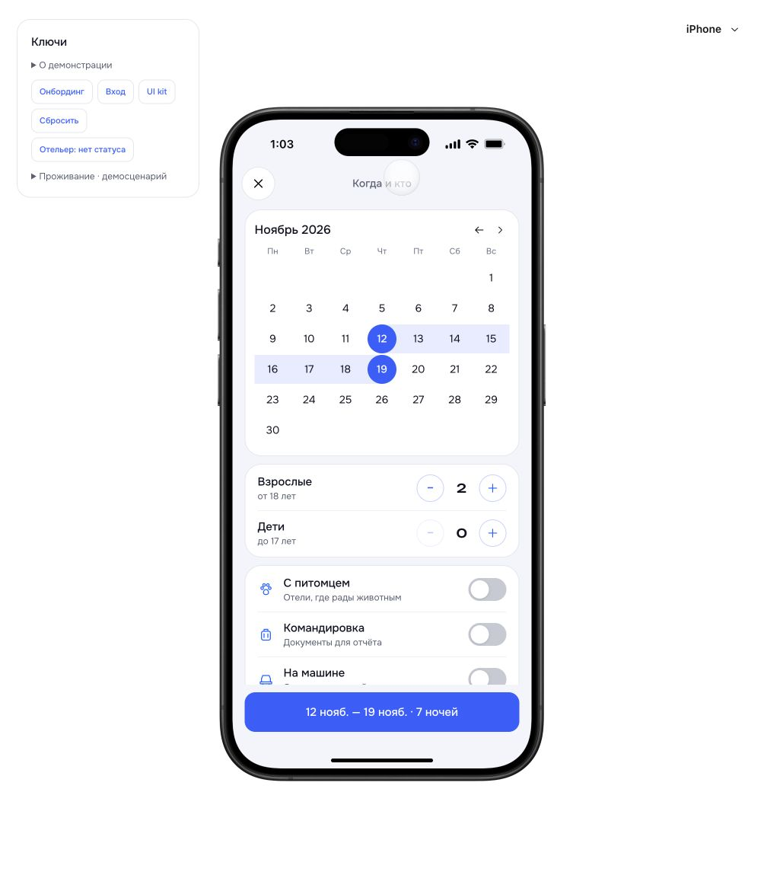

# k3 · Когда и кто

23.10.2026. Источник: «Ключи - Все экраны.dc.html», #k3.

Реализован экран вместо промежуточной шторки со ссылками на город/даты/гостей. Сохранены фон, карточки календаря и параметров, компактная шапка с крестиком, фиксированная нижняя кнопка. Все изменения применяются одновременно; до подтверждения запрос не изменяется.

Проверено в браузере: открытие из выдачи и карты, выбор дат и блокировка неполного диапазона, взрослые и добавление/удаление ребёнка, раскрытие возрастов, переключатель парковки, прокрутка длинного экрана, применение и пересчёт выдачи, повторное открытие, закрытие без сохранения, возврат на карту. После проверки исходный запрос восстановлен: Сочи, 12–19 ноября, 2 взрослых, без особенностей.

Сборка TypeScript/Vite и проверка 28 защищённых файлов runtime прошли. Существующее предупреждение о размере бандлов сохранено.

