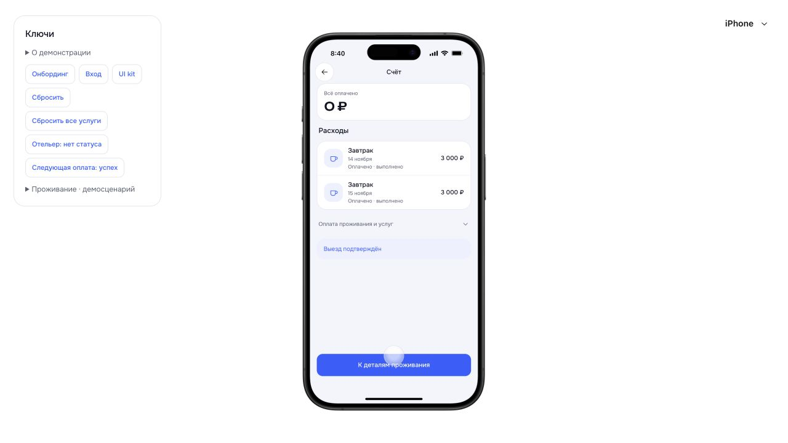
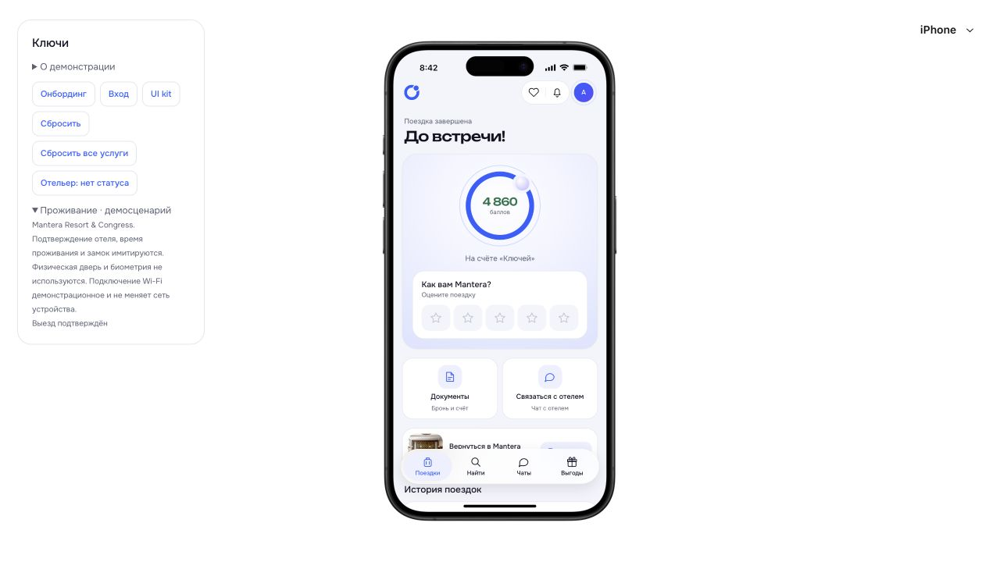

# Сквозная проверка итераций 4–5 · 26 октября 2026

Основной путь пройден в браузере от нового входа до сохранённого отзыва. Исправлены четыре дефекта интерфейса. Это проверка выбранного сценария, а не закрытие всех веток продукта и не попиксельная сверка всех макетов.

Проверка выполнена через Product Design на отдельном origin `127.0.0.1:5181`, с вымышленным гостем и отдельным локальным хранилищем. Пользовательские данные на `5173` не изменялись. Снимки сначала сохранялись, затем открывались для проверки. Визуальная основа — «Все экраны», выбранные Onest/Unbounded и поздние решения пользователя; исходные HTML h5/h7/h8/s2/s4 просмотрены, полный параллельный рендер эталонов в этом проходе не выполнялся.

## Пройденные шаги

| № | Шаг и действие | Наблюдаемый результат | Снимок |
|---|---|---|---|
| 1 | Вход, неверный SMS, затем верный код | Маска телефона; шесть ячеек с ошибкой; верный код автоматически открывает имя | [Вход](01-phone.png), [ошибка](02-sms-error.png) |
| 2 | Новый пользователь → поиск | До первого поиска нет недавних поисков; даты и гости открываются отдельно | [Найти](04-find-before.png), [гости](06-guests.png) |
| 3 | Сочи, 13–15 ноября, два взрослых → Mantera → номер | Компактная закреплённая шапка, карточки, тарифы; переходы доступны | [Выдача](07-results.png), [отель](08-hotel.png), [номер](09-rooms.png) |
| 4 | Гибкий без питания, ранний заезд с 10:00 | 28 400 − 1 420 + 2 500 = 29 480 ₽; время/услуга сохраняются | [Подтверждение после правки](24-confirmation-fixed.png) |
| 5 | СБП, демонстрационный отказ, повтор | При отказе сохраняются выбор и сумма; успешный повтор создаёт одну бронь | [Оплата](10-checkout.png), [ошибка](11-payment-error.png) |
| 6 | Предстоящая поездка | Фото выбранного отеля, ключ отсутствует, подбор по пожеланиям скрыт | [Поездка](13-upcoming.png) |
| 7 | Завтрак на всё проживание, две персоны | 2 дня × 2 гостя × 1 500 = 6 000 ₽; немедленная оплата без баллов/депозита; «Готово» возвращает к поездке | [Заказ](14-breakfast-order.png), [оплата](15-service-payment.png), [успех](16-service-paid.png) |
| 8 | Заселение отелем, открытие двери | Ключ появляется после заселения; один клик запускает отключённое «Открываем…»; после цикла кнопка снова доступна | [Проживание](17-stay.png), [кнопка после цикла](18-key-result.png) |
| 9 | Детали → счёт → назад | Счёт доступен из деталей проживания; два оплаченных завтрака по 3 000 ₽; переход назад работает | [Счёт после правки](23-bill-fixed.png) |
| 10 | День выезда → оформление отелем | Неинтерактивное напоминание; незавершённые услуги блокируют выезд; после их выполнения отелем показывается s4, ключ исчезает | [Напоминание](20-checkout-day.png) |
| 11 | Пять звёзд, текст, отправка, перезагрузка | Оценка передаётся в форму, отзыв сохраняется; вместо предложения оценить — компактная строка | [Сохранённый отзыв](22-completed-reviewed.png) |
| 12 | Повторная бронь без услуг → проживание → выезд | После прокрутки страницы на 608 px переход к завершению открывает верх экрана, scrollTop=0 | [Переход после исправления](25-completed-transition-fixed.png) |

## Исправленные дефекты

1. **Высокий приоритет: прокручивалась вся поверхность телефона.** При фокусе скрытого/нижнего элемента внешняя `.device-screen` получала scrollTop=339; статусная область уезжала, снизу показывалась скрытая клавиатура. Общий `useAppViewportGuard` удерживает внешний портал на нуле, оставляя прокрутку страницам и шторкам. Защищённый runtime не изменён. После исправления проверены гости, оформление, услуги и счёт. [До](03-empty-trips.png), [ещё один случай до](05-dates.png), [после](06-guests.png).
2. **Средний приоритет: завершённая поездка открывалась ниже начала.** MobileScroll сохранял позицию проживающей поездки при смене её статуса. Ключ компонента теперь включает ID брони и статус проживания. Повторный браузерный сценарий подтвердил переход с 608 px на 0. [До](21-completed.png), [после](25-completed-transition-fixed.png).
3. **Средний приоритет: итог счёта терял иерархию.** Вложенная обёртка обходила существующие стили: «Всё оплачено» слипалось с суммой. Восстановлена структура, для которой заданы стили s5: подпись и отдельная крупная сумма. [До](19-bill.png), [после](23-bill-fixed.png).
4. **Низкий приоритет: нулевые списания в подтверждении.** Строки баллов теперь появляются только при фактическом списании; сами расчёты не менялись. Проверен DOM подтверждения: нулевых строк нет, услуга и общая цена сохранены. [После](24-confirmation-fixed.png).

Исправленный счёт:

Завершение после перехода с прокрученной страницы:

## Проверки и границы

- `node --experimental-strip-types --test tests/*.test.mjs`: **175/175**. Запущены перед исправлениями представления; доменные расчёты в этом проходе не менялись.
- `npm run build`: TypeScript/Vite успешно; **28 защищённых файлов runtime** без изменений. Есть предупреждение о крупных JS-чанках — оптимизация загрузки остаётся отдельной задачей.
- В журнале ошибок проверяемой вкладки нет записей уровня error.
- Оплата, SMS, отель и дверь — демонстрационные. На снимке 18 видна кнопка после цикла, а не промежуточное успешное состояние; задержка «Открываем…» проверена взаимодействием, не покадровой записью.
- Этот проход выполнен в iPhone-оболочке. Pixel, внешняя мобильная вкладка, reduced motion, скринридер и полная клавиатурная навигация повторно не проверялись.
- Изменение/отмена брони, поздние возвраты услуг, Friendly Rate, полная оплата баллами, права получателя общей брони не проходились заново в браузере. Для них сохраняются предыдущие отчёты и доменные проверки; текущий отчёт их не заменяет.
- Поиск диалогов, непрочитанное, чат без брони и подключение сотрудника остаются вне реализованного объёма P-027. Автоматический перенос оплаченных услуг при смене дат также не реализован.

## Следующий ограниченный проход

Итерация 6: персональный подбор → карточки отелей → избранное → слежение за ценой. Сначала сверить существующие q1–q3/w1 с источниками, восстановить сохранение результатов/пустые состояния и связать переходы с общим поиском. Персональный порядок и вертикальные жесты требуют отдельной проверки; реальные уведомления не подключать. Итерации 4–5 остаются в работе до проверки перечисленных дополнительных веток и платформ.
