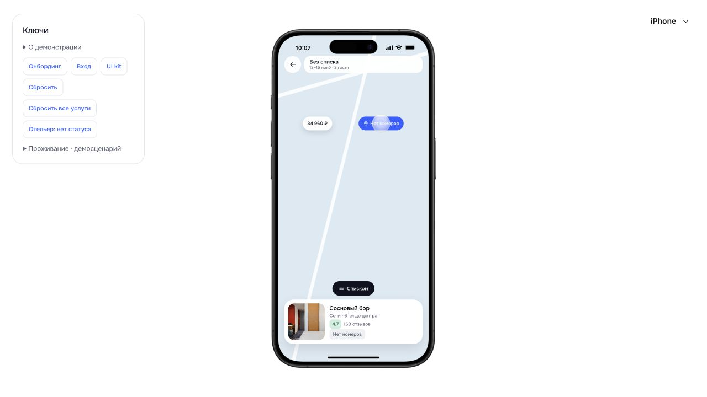
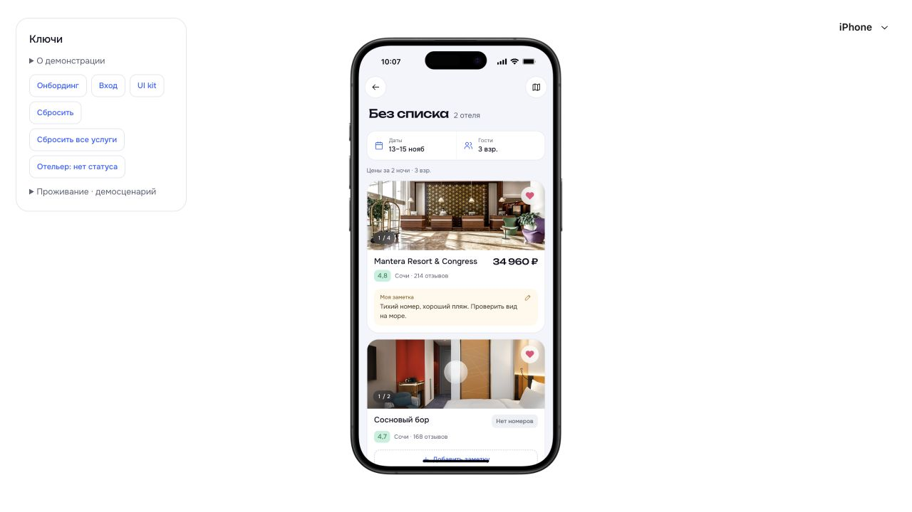
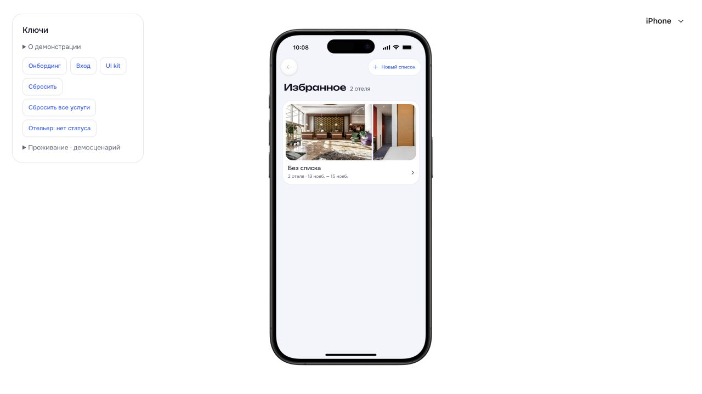

# Карта избранной подборки · D-074

26.10.2026. Проверка на отдельном origin `127.0.0.1:5181`, без изменения пользовательских данных на `5173`.

- Кнопка карты занимает место прежних трёх точек в шапке подборки.
- На карте только два отеля выбранного тестового списка; метка «Соснового бора» переключает нижнюю карточку.
- Карточка открывает отель. После перезагрузки возврат ведёт на карту исходной подборки; «Списком» возвращает подборку, затем назад — список подборок.
- При трёх взрослых Mantera пересчитывается на доступный номер, у «Соснового бора» вместо цены появляется лейбл «Нет номеров». Недоступный отель остаётся и на карте. Три точки в карточках отсутствуют.
- Пустой новый список открывает пустую карту, чужие избранные отели не подставляются.
- У кнопок «Назад» и «Новый список» совпадают верхний/нижний края. Логическая высота обеих — 44 px; в проверенном масштабе DOM: top 107.306, bottom 137.851, height 30.545 px.
- Раскрытие использует общий ExpandingMap; underlying список inert. Обработчики и расчёт цены общие с избранным. Карта по-прежнему демонстрационная схема c2, без подключения картографического сервиса.

`node --experimental-strip-types --test tests/favorites.test.mjs` — **8/8**. Сборка TypeScript/Vite и целостность 28 защищённых файлов прошли. Предупреждение о больших чанках остаётся.

