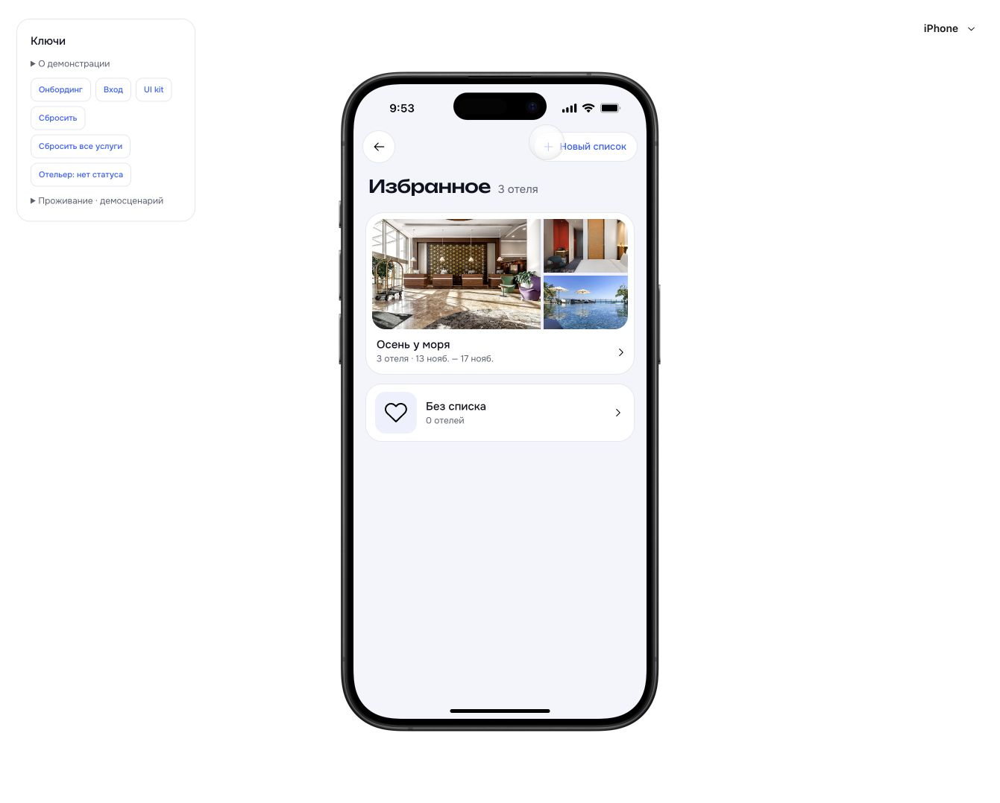
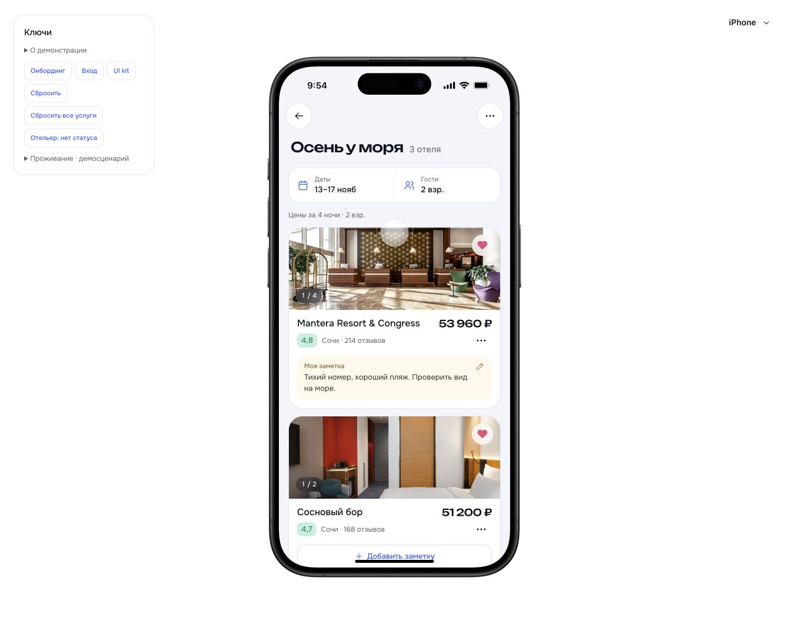
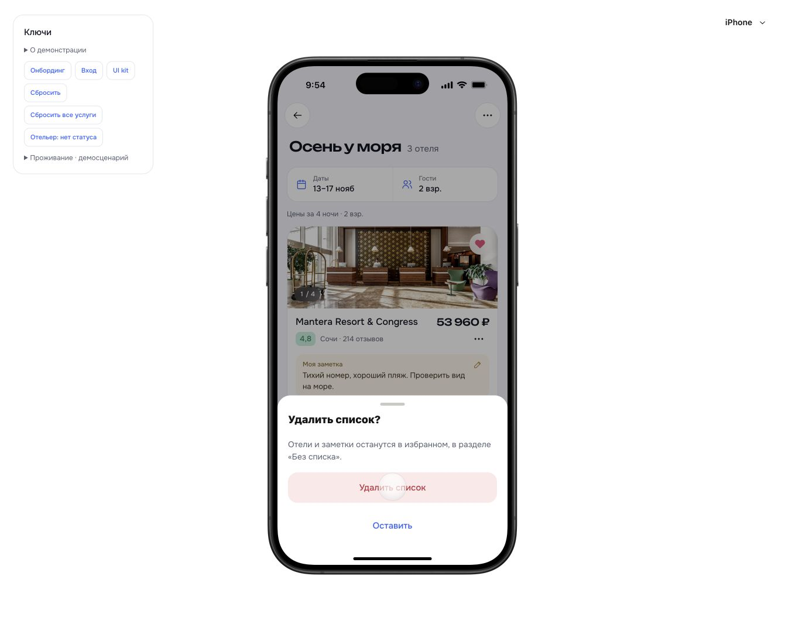

# Избранные списки и заметки · 26.10.2026

Плановый проход F10/F11, рабочее решение P-030. Визуальная основа — fv1/fv2/fv2a/fv4/fv5/fv6 из «Все экраны». Даты и гости открываются раздельно по поздним решениям пользователя, а не совмещённым fv3. Синие сердца исходника заменены утверждёнными розовыми D-019.

## Проверка в браузере

Отдельное хранилище `127.0.0.1:5181`, вымышленный профиль. Пользовательские брони на `5173` не менялись. Проверены iPhone и Pixel 10.

| Сценарий | Результат |
|---|---|
| Открыть старое плоское избранное | Сохранённый ранее Mantera доступен в «Без списка» без сброса данных |
| Добавить заметку с экранной клавиатурой | Текст и счётчик отображаются, кнопка сохранения доступна над клавиатурой |
| Переместить отель с созданием списка «Море осенью» | Отель перемещён, заметка сохранена; исходный список стал пустым |
| Открыть отель, перезагрузить, нажать назад | Открылась исходная подборка с заметкой; следующий возврат — список подборок |
| Изменить 13–15 ноября на 13–17 ноября | Стоимость Mantera изменилась с 26 980 ₽ на 53 960 ₽; обычный поиск остался на 13–15 ноября |
| Переименовать подборку | «Осень у моря», состав, даты и заметка сохранены |
| Первое сохранение из выдачи после reload | Открылась шторка выбора списка; после выбора сердце стало розовым |
| Следующее сохранение в той же сессии | Отель добавился в тот же список, повторная шторка не открылась |
| Создать пустой список через шапку | Открыт пустой список с переходом к поиску; создание и удаление работают |
| Удалить список с тремя отелями | Все три отеля и заметка остались в «Без списка» |
| Действия нижней карточки и удаление отеля | Карточка доступна после прокрутки, число отелей уменьшилось; остальные остались |
| Гости на Pixel 10 | Отдельная шторка взрослых/детей, без особенностей поездки; безопасные области соблюдены |

## Автоматические проверки

`node --experimental-strip-types --test tests/*.test.mjs` — **191/191**. Восемь новых тестов проверяют совместимость старого избранного и изоляцию владельцев, названия/дубликаты, перенос заметки, удаление без изменения брони/платежа, границу 1000 символов, расчёт цены и независимость поиска, недоступный отель, параметры брони и сохранённый возврат.

`npm --prefix app run build` — TypeScript/Vite и проверка 28 защищённых файлов прошли. Ошибок уровня error в тестовой вкладке нет. Предупреждение Vite о крупных чанках сохраняется.

## Границы прохода

Списки и заметки локальные, принадлежат профилю. Один отель находится в одном списке; перенос не создаёт дубликат. Удаление списка переносит отели в «Без списка», удаление самого отеля удаляет его заметку. Это рабочие безопасные правила реализации, не новое коммерческое решение пользователя.

Публичная ссылка «Поделиться списком», совместное редактирование и быстрый перенос непосредственно из уведомления fv5 не реализованы. Перенос доступен в действиях карточки. Недоступные отели остаются в списке с действием изменения дат; сохранённые цены не выдаются за актуальные. Для них проверки выполнены на уровне логики. Полная итерация 6 не закрыта.
