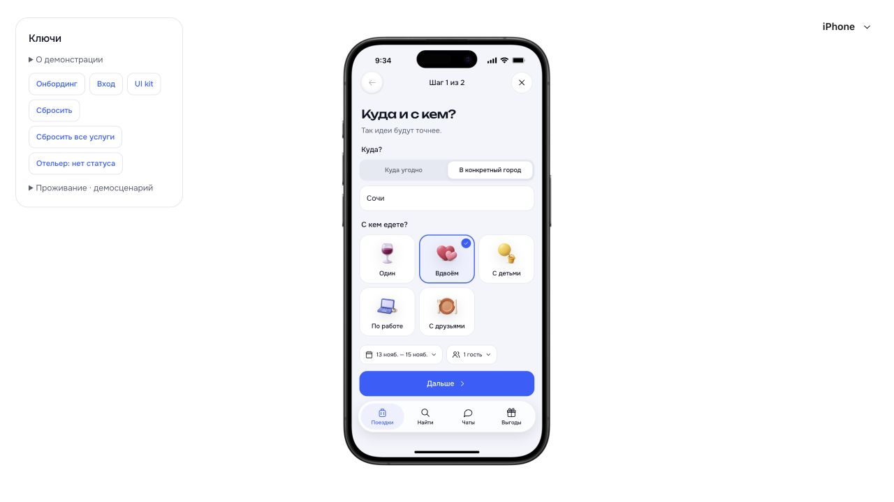
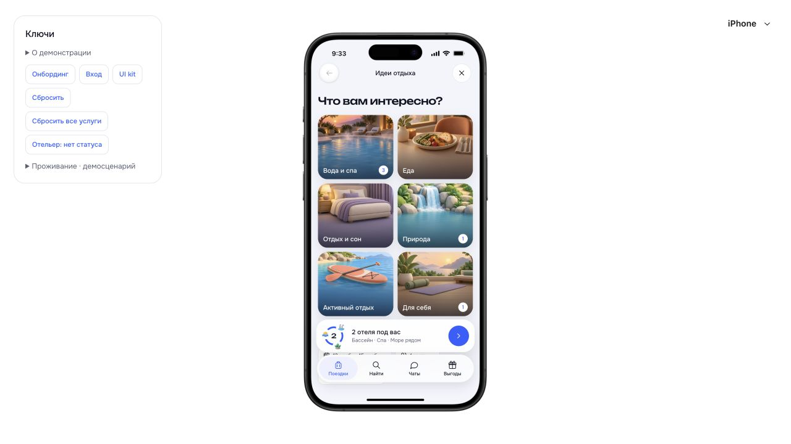
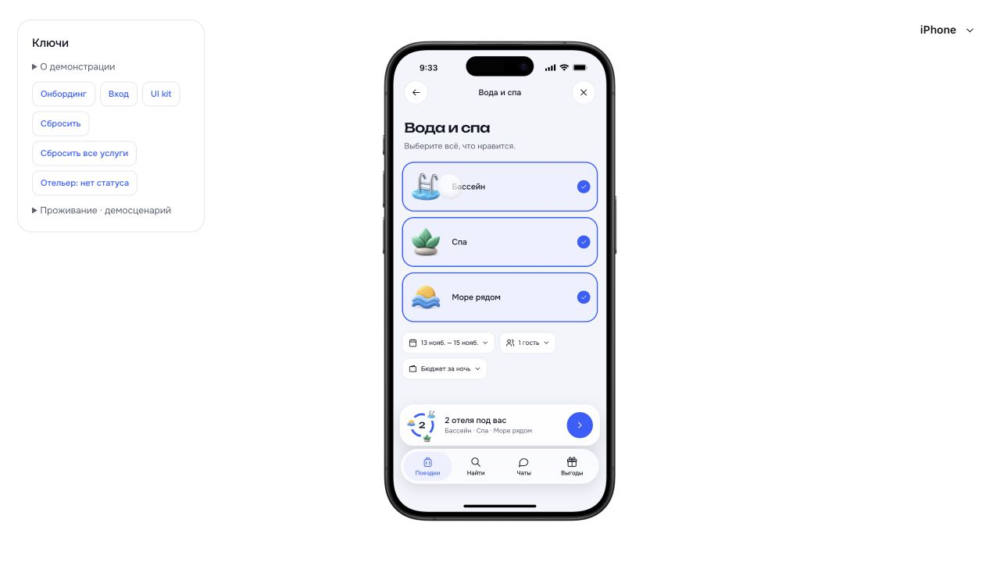
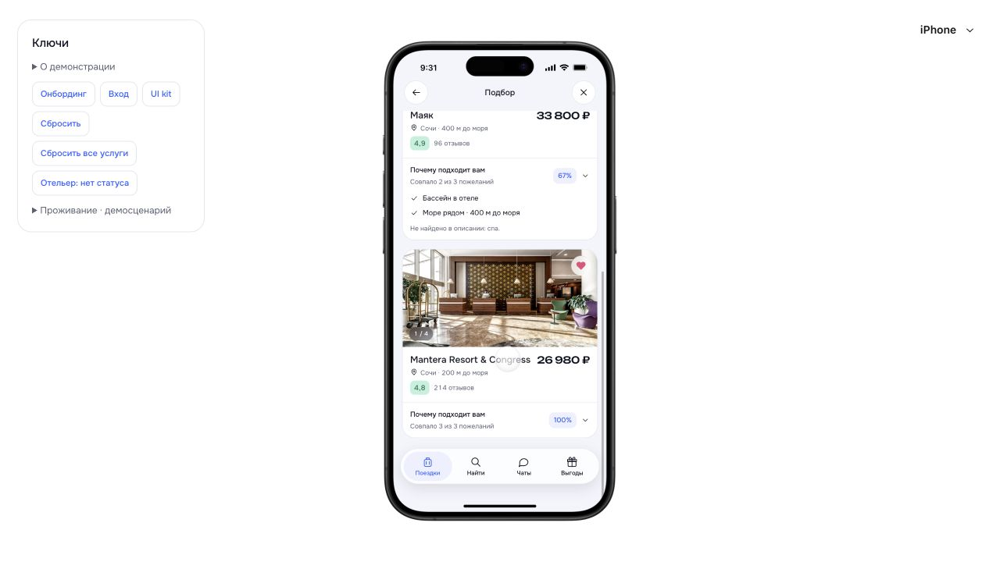
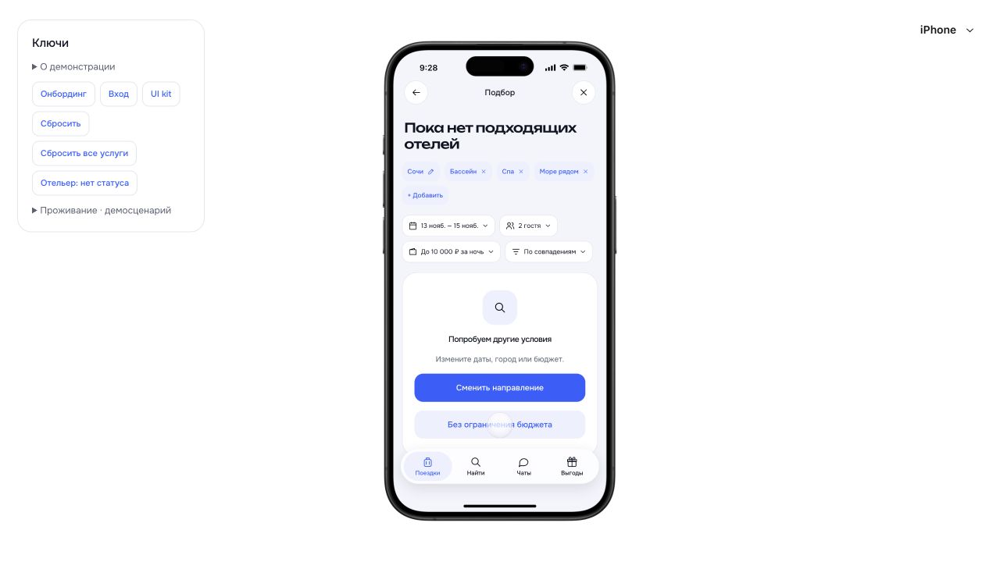

# Проверка подбора · 26.10.2026

Проверка в отдельном хранилище браузера `127.0.0.1:5181`, вымышленный профиль. Пользовательские брони и настройки на `5173` не изменялись. Исходные композиции nc2/nc3/nc6/nc7/r1 изучены по HTML, использованы оригинальные WebP. Это проверка реализованного прохода, не всех экранов подбора.

| Шаг | Действие | Результат |
|---|---|---|
| 1 | Начать подбор из завершённой поездки | Отдельная страница направления/компании; до выбора продолжение отключено |
| 2 | Ввести «Соч», перезагрузить | Ввод сохранён, город ещё требуется выбрать из подсказок |
| 3 | Сочи → вдвоём → вода и спа | Исходные иллюстрации и состояния выбора; выбранные интересы отмечены в темах |
| 4 | Выбрать бассейн, спа, море; выйти через «Найти», вернуться через «Продолжить подбор» | Восстановлены текущая тема и все три выбора |
| 5 | Бюджет до 10 000 ₽ | Пустая выдача; снятие ограничения возвращает отели |
| 6 | Раскрыть совпадения | Mantera — 3/3, Маяк — 2/3; для Маяка указано отсутствие спа в описании, без ложного совпадения |
| 7 | Сортировать по оценке | Маяк перемещается выше Mantera, выбранные интересы сохраняются |
| 8 | Сохранить Mantera | Розовое сердце; отель появляется в общем избранном после выхода |
| 9 | Открыть Mantera, включить слежение, перезагрузить | На странице отеля «Следим за ценой», в w1 доступно «Перестать следить» |
| 10 | Из отеля назад после перезагрузки | Восстанавливается выдача подбора; назад из неё ведёт в темы и затем в направление |
| 11 | Изменить гостей подбора с двух до одного, открыть обычный поиск | Обычный поиск остаётся на двух взрослых; даты/гости подбора независимы |
| 12 | Снова открыть отель из подбора | В h1 показаны бассейн, спа и море — совпадения с текущими пожеланиями |

## Автоматические проверки

`node --experimental-strip-types --test tests/*.test.mjs` — **183/183**. Семь новых тестов: восстановление/изоляция владельцев, проверяемое ранжирование, точная граница бюджета, обязательный город и даты, переход в бронь с сохранением обычного поиска, сортировка и отсутствие скрытых ограничений от предыдущего поиска. Снимок совпадений сохраняется в черновике бронирования.

`npm --prefix app run build` — успешно. TypeScript/Vite, целостность 28 runtime-файлов — успешно. В журнале тестовой вкладки ошибок уровня error нет. Предупреждение Vite о крупных JS-чанках сохраняется.

## Ограничения

Проверена iPhone-оболочка. Pixel/reduced motion и внешний мобильный браузер в этом проходе не проверялись. Общая навигация и движение используют существующие компоненты и токены, без новых таймеров. Полная лента идей, свободный текст, районы, подборки/заметки избранного и управление списком слежений остаются в [плане итерации](../README.md). Подбор по свободному тексту не заменён внешним ИИ. Проценты совпадений относятся только к доступным признакам демокаталога.
