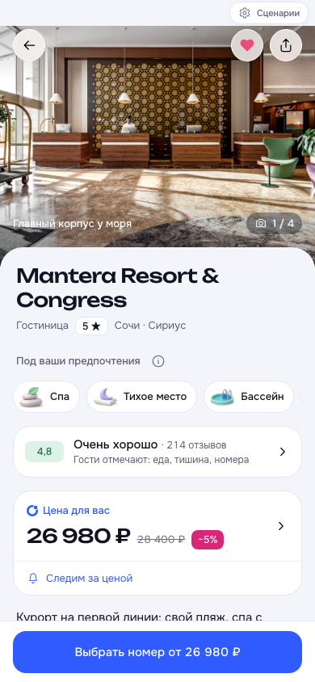

# Расширение совпадений с предпочтениями · 02.11.2026

- Все 53 отеля × 10 стилей: минимум три критерия, без повторений; иллюстрации определяются для каждого тега.
- Три базовых критерия — демонстрационные данные. Они не означают три специфических совпадения со стилем; подробности в [контракте](../../handoff/HOTEL-PREFERENCES.md).
- Рекомендованная выдача учитывает тематические признаки; сортировка по цене сохраняется.
- 393 автоматических теста прошли, сборка Pages и проверки брендбука, спецификации и ссылок прошли.
- iPhone 13, 390 × 844: карточка отеля → изменение предпочтений → «Спа и здоровье» → сохранение → шесть тегов. Сначала спа, тихое место, бассейн; затем базовые критерии. Справка объясняет источник. Ошибок JavaScript нет.

