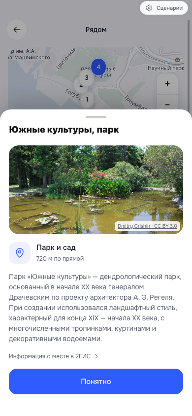
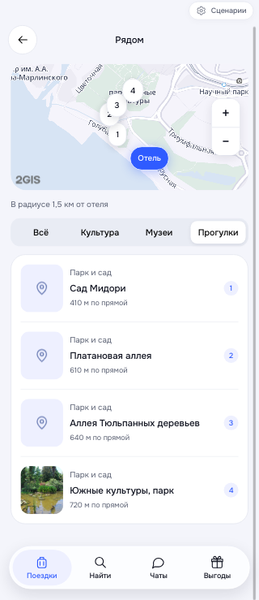

# Реальные места рядом · 02.11.2026

Проверены мобильные 390×844 и 320×740, сценарий trip-nearby / Mantera.

- Список и метки карты, переключение категорий и возврат из карточки.
- Две метки музеев в одной точке доступны отдельно.
- Реальное фото парка «Южные культуры», загрузка и подпись автора/лицензии.
- Кнопка «Понятно» закрывает карточку, выбранная категория сохраняется.
- 387 тестов прошли; build:pages, 28 protected runtime files, validate_brand/product_spec/pages прошли.
- Все 270 связей отеля с местом проверены формулой расстояния: не более 1500 м от конкретного отеля. У вымышленных и неизвестных отелей чужих подборок нет.
- Routing API подтвердил поддержку пешего маршрута, затем вернул HTTP 429. Текущий снимок показывает расстояния по прямой; минуты не выдуманы.
- 25 фотографий на 240 уникальных мест; остальные имеют нейтральную заглушку. Фото не являются ответом Places API.

## Уточнение иллюстраций и карточек

По запросу пользователя добавлено пять тематических изображений ImageGen; реальные фото имеют приоритет, при ошибке внешнего изображения используется иллюстрация. У всех 240 мест есть локальный запасной вариант. Номера из строк удалены, расстояние обозначается ≈, блок «Почему вам может понравиться» восстановлен.

Проверено Playwright на 390 × 844 и 320 × 740: загрузка фото, открытие и закрытие деталей, фильтр музеев, отсутствие горизонтального переполнения и ошибок JS. Скриншоты: illustration-detail.png, illustration-narrow.png. 388 автоматических тестов прошли, Pages-сборка и проверки брендбука, спецификации и ссылок успешны.
