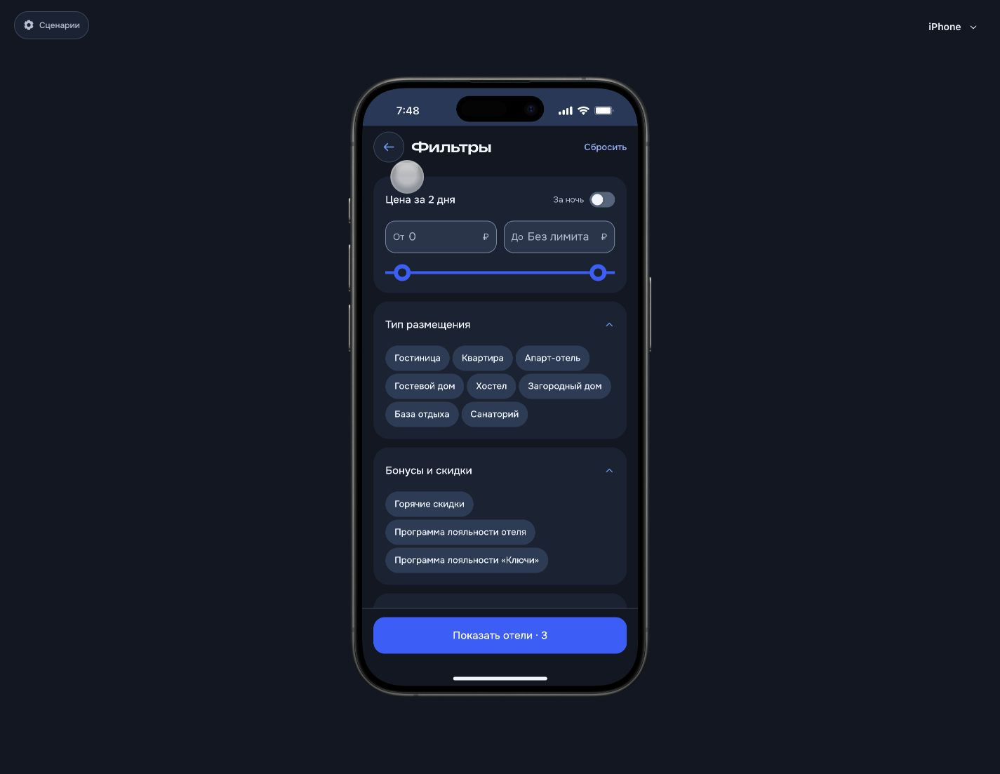
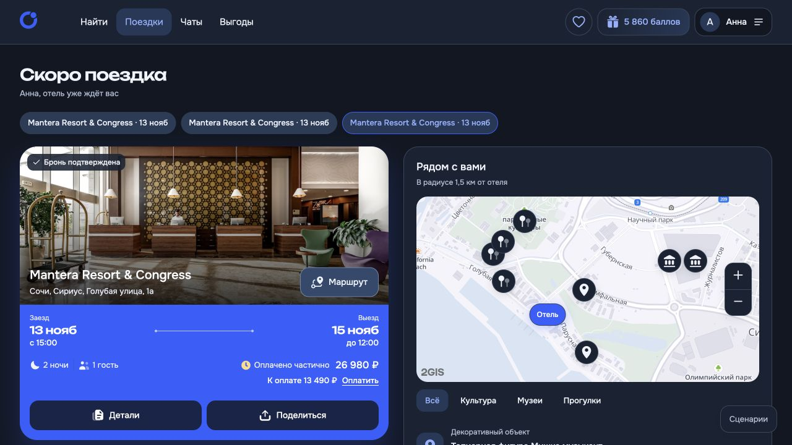
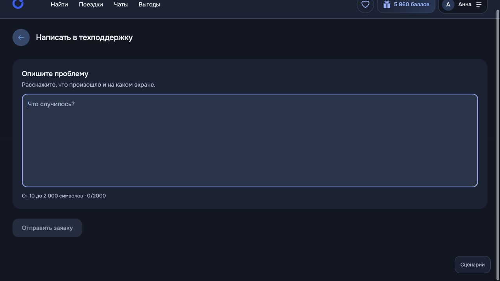
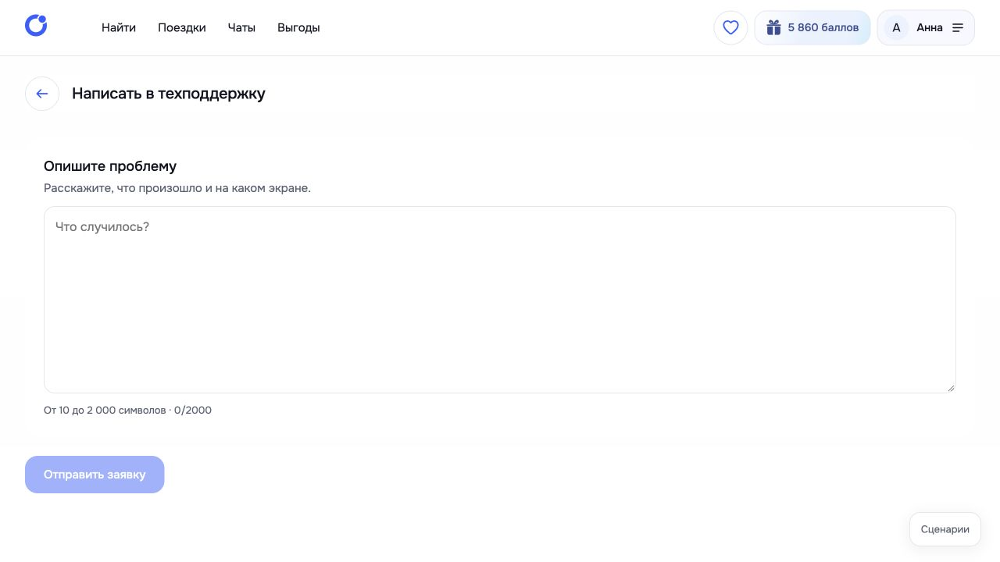

# Контраст тёмной темы · 12.11.2026

Проверка и исправления по запросу пользователя: различимость полей, кнопок и устранение декоративных рамок. Изменения локальные.

## Проверенные участки

1. **Поиск и фильтры — исправлено.** Мобильные выдача, календарь, фильтры; десктопное поле города. Поля получили отдельную поверхность, контрастные подсказки и осмысленную границу. Вынесенный в портал редактор фильтров использует те же правила; невыбранные параметры различимы.
2. **Оформление — исправлено.** Поля гостя, гражданство, списание баллов и частичная сумма. У информационных карточек и корзины удалены декоративные внешние рамки; внутренние разделители сохранены. Фокус и ошибка различаются. У телефона сохранён спокойный серый фокус.
3. **Поездка и детали брони — исправлено.** Кнопки на синей карточке имеют собственную тёмную подложку и белые подписи; мелкий текст на кобальтовом фоне усилен. Информационные карточки отделяются поверхностью, а не множеством рамок.
4. **Техподдержка — исправлено.** Поле заметно относительно карточки, фокус читается, неактивная кнопка отличается от доступной. Светлая версия этого экрана проверена отдельно и сохранена.
5. **Общие компоненты — исправлено.** Вторичные кнопки, кнопки-иконки, счётчики, focus-visible, поля, плейсхолдеры, ошибки, состояния disabled и active. Смысловые рамки выбора тарифа, способа оплаты и дат сохранены.

## Измерения палитры

| Пара | Контраст |
|---|---:|
| Основной текст / поле | 11,23:1 |
| Плейсхолдер / поле | 6,34:1 |
| Граница / поле | 3,24:1 |
| Текст вторичной кнопки / фон | 8,20:1 |
| Текст вторичной кнопки / hover | 6,69:1 |
| Мелкие подписи / кобальтовый фон поездки | 4,69:1 |

Автотест проверяет минимум 4,5:1 для текста и 3:1 для границ полей. До исправления мелкие подписи поездки имели 4,33:1. Дополнительно проверены вычисленные цвета текста DOM на просмотренных экранах. Это проверка общих компонентов и перечисленных сценариев, а не сертификат соответствия каждого возможного состояния WCAG. Контраст поверх фотографий/градиентов проверялся визуально; географическая подложка 2ГИС сохраняет собственную палитру.

## Реализация и проверки

- `app/src/theme-contrast.css`: все правила ограничены `html[data-app-theme="dark"]`; импорт после основной темы.
- `tests/dark-contrast.test.mjs`: регрессия контрастных пар.
- 4 теста темы и контраста прошли; production-сборки мобильной и десктопной версии прошли.
- Проверка целостности 28 защищённых файлов runtime прошла.
- Во время QA не отправлялись заявки и не подтверждалась оплата. Тестовый текст обращения очищен; пробные переключатели списания баллов выключены.

## Скриншоты после исправлений

Исходные снимки до изменений и дополнительные состояния сохранены локально в `.desktop-work/dark-contrast/`.
